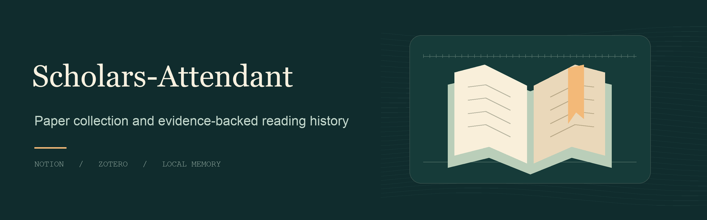
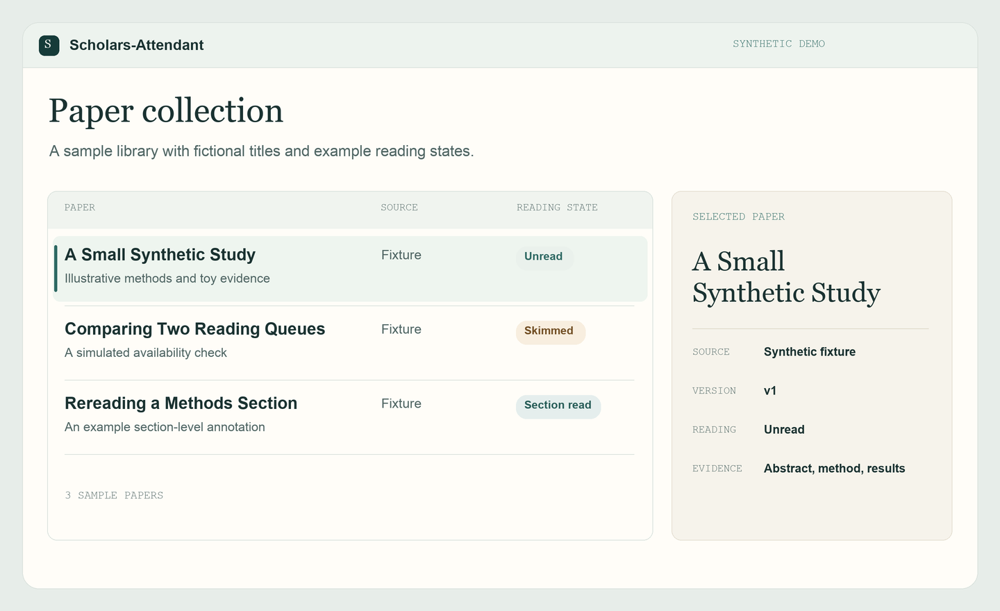
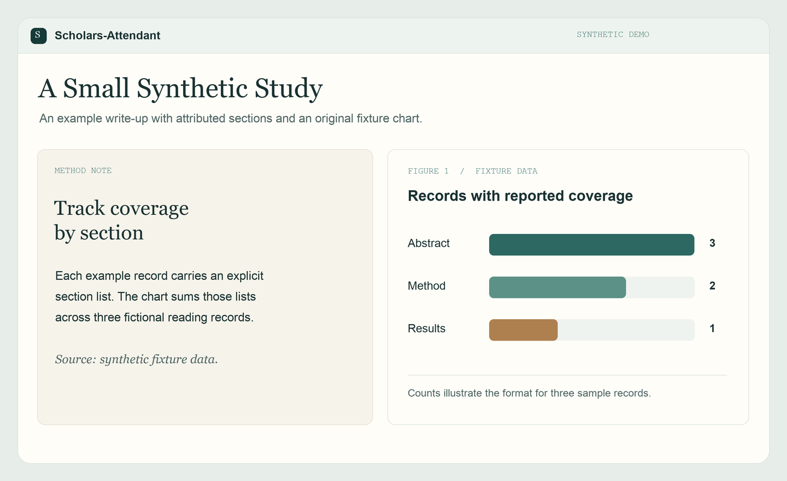

# Scholars-Attendant (书僮)



Scholars-Attendant collects research papers, helps you prepare sourced Notion write-ups, and records what you have actually read in a local research library. The core keeps paper versions, source evidence, and reading history distinct.

## Try the core

This demo uses a temporary SQLite database and synthetic research records. It runs without Notion, Zotero, model credentials, or Docker.

```sh
git clone https://github.com/Akutagawa1998/Scholars-Attendant.git
cd Scholars-Attendant
python3 -m venv .venv
.venv/bin/python -m pip install -r requirements.lock
.venv/bin/python -m pip install --no-build-isolation .
.venv/bin/python evals/run_memory_demo.py
```

Use Python 3.12 or later. The demo covers paper import, section-level reading, retrieval with evidence, correction, export, and forgetting. See the [local setup guide](deploy/README.md) for persistent PostgreSQL, the local HTTP service, and stdio MCP.

## Collect and write with Codex

From the checkout, run `bash scripts/install-codex-skills.sh`, then start a fresh Codex session. Connect Notion and select the collection to use. Try asking Codex to save the metadata for a paper link into that collection. Ask for a separate write-up or translation when needed.

The skills cover paper identification, figures, tables, equations, Notion writing, and shared research context. The [Codex plugin manifest](.codex-plugin/plugin.json) also packages the skills. The reading and memory skills use the core's MCP tools when configured.

## Collect and write with OpenClaw

Use OpenClaw 2026.11.4 or later on [a supported runtime](https://docs.openclaw.ai/install/node). From the checkout, use `openclaw plugins install --link .`. Supply `NOTION_API_TOKEN` (or `NOTION_API_TOKEN_FILE`) to the gateway privately. Grant the integration access to a selected Notion page or single-data-source database. Use `notion_setup` to create a new collection under a shared parent, or configure `databaseId` for an existing collection that has the same paper properties. The [OpenClaw install guide](https://docs.openclaw.ai/cli/plugins/install) describes enabling and inspecting the plugin.

- **Agent mode** is the default. `notion_save_paper` looks for an existing record by source or canonical paper URL before saving. `notion_write_page` appends to a selected page or managed block. Use `notion_create_child_page` to keep a long-form write-up separate.
- **API mode** enables `generate_paper_summary`. Set `mode: "api"`, choose a provider model, and supply the matching API key from [.env.example](.env.example) privately. The tool fetches available arXiv content, sends it to the chosen provider, and creates a new Notion child page under the supplied parent. Set `create_chinese: true` to request a Chinese child page. It uses a separate model call.
- In Paper Collector 2.0, `clear_existing: true` is a validation error. Keep existing content by selecting a managed block, or use a new child page. The `page_id` accepted by API-mode generation refers to the parent for the new summary.

For existing databases, create the optional `Conference` select and `备注` rich text properties to save those fields. Newly created collections include both properties. To troubleshoot a partial write, inspect the URL or destination ID reported by the tool before retrying.

## Synthetic previews

These illustrations use fictional titles, reading states, and fixture data. The chart is original to the demo.





## Current scope

The core targets an individual local deployment. PostgreSQL is the persistent backend. HTTP is loopback-only by default, and the MCP proxy uses the same service and bearer token. An import establishes a source record. Confirmed reading requires a trusted capture event. Assistants can save proposals when trusted capture is unavailable.

Notion and Zotero sync are explicit operator workflows. Automatic conversation capture, a review scheduler, managed Notion writeback from core memory, and production restore with privacy-ledger replay are outside the current implementation. See the [local setup guide](deploy/README.md) for storage and backup boundaries.

## Contributing and license

See [CONTRIBUTING.md](CONTRIBUTING.md) for tests and reporting. Code, documentation, and original demo graphics are distributed under the [MIT license](LICENSE).
